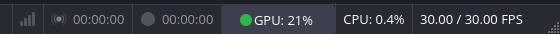
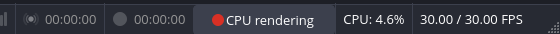
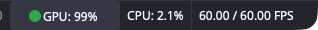

# GPU acceleration status light

OBS-Studio-Rust shows a light in the status bar that says whether video is
rendered on a hardware GPU (obs-rust/obs-studio#846). Clicking it opens a
dialog that explains the state and lists likely causes. The same state is
logged at startup and returned by obs-websocket as `GetStats.gpuAcceleration`.

| Light | Meaning |
|---|---|
| Green | OBS renders on a hardware GPU (any vendor: the driver is bound and the active adapter confirms it). |
| Yellow | No GPU was found and OBS renders in software (llvmpipe, softpipe, Microsoft Basic Render Driver, SwiftShader). Expected on a VM or headless machine. |
| Red | A GPU (NVIDIA, AMD or Intel) is present but OBS renders in software, graphics initialization failed, or frames are over budget. |

**Frame budget.** Once a second the frontend samples libobs' one-second
average frame time (`obs_get_average_frame_time_ns`). The light compares
the **median** of the last 15 samples with the frame interval and ignores
frame timings until it has at least 5 samples, so one slow second (for
example right after launch) does not turn it red (#929). Frames over budget are red.

**Adapter.** The adapter is the renderer OBS actually uses: `GL_VENDOR` and
`GL_RENDERER` on OpenGL, and the active DXGI adapter on Direct3D 11. It is
not `gs_get_device_name()`, which only names the API (`OpenGL`).

**Label (#1025).** The light has a text next to its dot, and the dot keeps
the color above:

| Label | When |
|---|---|
| `GPU: 37%` | OBS renders on a hardware GPU and a source reads it. The percent is the whole adapter, as Task Manager or nvtop show it. |
| `GPU: n/a` | No source reads the render GPU (the tooltip says so), or graphics initialization failed. |
| `CPU rendering` | OBS renders in software. A GPU that OBS does not use can show 0 %, so the label shows no percent. |

On an RTX 3060 (NVML), and on the same machine forced onto llvmpipe
(red, because a GPU is present):

On an M1 Max (IOKit) under a Metal compute load:

The sources, in order: NVML for NVIDIA (#1021), then amdgpu's
`gpu_busy_percent` on Linux (#1024), on macOS IOKit's
`Device Utilization %` of the render GPU's `IOAccelerator` (#1026; the
key is not documented, and an M1 Max has it), and on Windows the PDH
`GPU Engine` counters of the render GPU's DXGI LUID (#1022), as Task
Manager reads them, for every vendor. NVML cannot find the GPU on Windows
yet (it needs the LUID as a PCI address), so PDH reads NVIDIA there too.
The thread `obs-gpu-usage`
reads the source once a second, so the UI thread never waits for one.
`GetStats.gpuAcceleration` has the same reading as `usage` (`percent`,
`source`, or `null`) and the label as `readout`.

**No share of OBS.** #1004 put OBS's own share in the tooltip. NVML's
per-process samples do not give one: on the RTX 3060 above, an OBS that
rendered 4K at 25 fps the whole time had no sample in 4 of 7 two-second
windows, and 45 % in one while the device average was 20 %
(`nvidia-smi pmon` reads the same values). The label shows the whole GPU
only until a source gives a share that adds up.

An earlier mockup of the dialog for a machine with no GPU (the styling is approximate). Since #1005 that case is yellow, not red; a GPU OBS can't use is red:

## Where it lives

- Classifier, GPU detection (`/sys/class/drm`, `/dev/dri`, `nvidia-smi`), the
  frame window (`FrameStats::from_samples`, `median()`) and the dialog text:
  `rust/obs-gpu-status`.
- Reading the adapter: `ActiveAdapterName()` in
  `frontend/utility/GpuStatus.cpp`, with `GetGlGetStringProc()` in
  `frontend/utility/platform-x11.cpp`, `platform-windows.cpp` and
  `platform-osx.mm`.
- Label text and sources: `rust/obs-gpu-status/src/usage.rs`
  (`Sampler`, tested with injected sources), `Report::readout()`, and
  `platform::usage_sources()`; the sampling thread is in `src/ffi`. The
  macOS parser is `src/iokit.rs`, its reader `accelerator_statistics()` in
  `src/platform/macos.rs`.
- Light and dialog: `frontend/utility/GpuStatus.cpp` and
  `frontend/widgets/OBSBasicStatusBar.cpp`. They are built whenever cargo
  is available, whatever `ENABLE_RUST_LIBOBS` (the app's name) says
  (`frontend/cmake/feature-gpu-status.cmake`, option `ENABLE_GPU_STATUS`).
  A build without cargo, such as the Flatpak sandbox today, configures
  without the light and prints a warning (#946).
- `GetStats.gpuAcceleration`: obs-websocket reads it from the frontend's
  `get_gpu_status` proc, and it is `null` when nothing provides it.
- Tier 4 check (OpenGL forced onto llvmpipe → not green):
  `test/websocket-tier4/run_tier4.py`.
